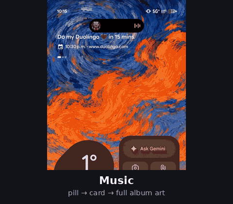
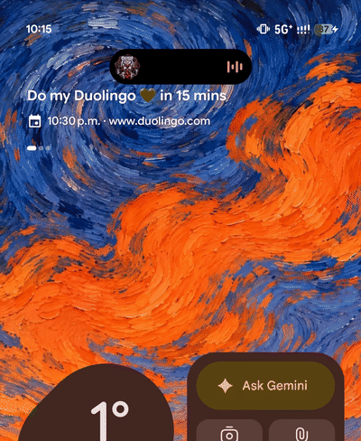
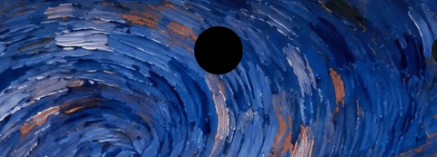
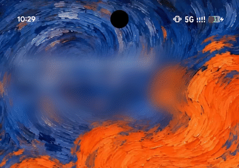
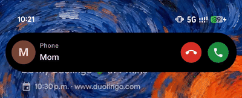
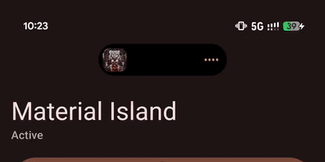

<p align="center">
  <picture>
    <source media="(prefers-color-scheme: dark)" srcset="brand/lockup-horizontal-color-dark.svg">
    
  </picture>
</p>

<p align="center">
  <b>Isla dinámica para Android con el estilo del Pixel.</b><br>
  Colores Material You y formas y muelles de Material 3 Expressive alrededor de la cámara.
</p>

<p align="center">
  <a href="https://github.com/JotnarDev/material-island/releases/latest"></a>
  <a href="https://github.com/JotnarDev/material-island/releases"></a>
  <a href="https://github.com/JotnarDev/material-island/stargazers"></a>
  <a href="https://github.com/JotnarDev/material-island/issues"></a>
  
  <a href="LICENSE"></a>
</p>

<p align="center">
  
</p>

<p align="center">
  <a href="https://github.com/JotnarDev/material-island/releases/latest"></a>
  &nbsp;
  <a href="https://apps.obtainium.imranr.dev/redirect?r=obtainium://add/https://github.com/JotnarDev/material-island"></a>
  <br>
  <sub>Android 12+ · ~3 MB · sin cuenta · se actualiza sola desde GitHub</sub>
</p>

<p align="center">Si te gusta, una ⭐ ayuda a que más gente la encuentre.</p>

<p align="center">🇬🇧 <a href="README.md">English version</a></p>

---

Material Island convierte el hueco de la cámara en una superficie viva para lo que pasa en tu teléfono: música,
llamadas, temporizadores, navegación, descargas, carga, códigos de verificación, chats sin leer y, con **At a glance**,
clima, marcadores y bolsa. Funciona en cualquier Android 12 o superior, también en Xiaomi, Redmi y POCO.

## ¿Por qué estos permisos?

- **Acceso a notificaciones** lee las notificaciones de las apps que reproducen, llaman, cuentan tiempo o navegan, para mostrarlas en la isla. No se guarda ni se envía nada.
- **Servicio de accesibilidad** solo sirve para dibujar la isla sobre la barra de estado y saber qué app está delante (para ocultar la música si su app está abierta). Nunca lee lo que hay en tu pantalla.
- **ADB es opcional.** Solo evita la pantalla de "ajustes restringidos" de Android y activa extras como *Island first*.
- **Puedes comprobarlo.** El código es abierto: mira las [notas técnicas](#notas-técnicas) y [`service/`](app/src/main/java/dev/jotnar/materialisland/service/).

## En movimiento

<table>
  <tr>
    <td width="50%" valign="top"><b>Música en tres pasos</b><br>Píldora, tarjeta y carátula grande con los controles sobre un desenfoque progresivo.<br><br></td>
    <td width="50%" valign="top"><b>Gota líquida</b> (cámara lenta)<br>Estilo de apertura opcional: una gota se estira desde la cámara, se suelta y se abre.<br><br></td>
  </tr>
  <tr>
    <td valign="top"><b>Carga</b><br>Anillo ondulado, porcentaje que sube y un barrido de luz. Al tocarla: tiempo hasta el 100 %, velocidad, cable o inalámbrica, vatios y temperatura.<br><br></td>
    <td valign="top"><b>Accesos desde la cámara</b><br>Toca la cámara en reposo y sale una tarjeta con los accesos que elijas.<br><br></td>
  </tr>
  <tr>
    <td valign="top"><b>Llamadas</b><br>Contesta desde la isla y el tiempo de llamada queda en una píldora compacta.<br><br></td>
    <td valign="top"><b>Mensajes</b><br>Un banner con responder y marcar como leído que vuelve a la cámara.<br><br></td>
  </tr>
</table>

## Qué hace

| Tipo | Compacta | Expandida |
|---|---|---|
| Música | Carátula con forma de galleta que gira + ecualizador | Carátula que cambia de forma al pausar, barra ondulada con arrastre, botón play que cambia de forma |
| Llamadas | Icono verde que late + "Entrante" o cronómetro | Contestar / rechazar / colgar al estilo del marcador del Pixel |
| Temporizadores | Cuenta atrás en vivo | Número grande + acciones del Reloj |
| Navegación | Flecha de giro + distancia | Instrucción, llegada, salir |
| Descargas / Live Updates | Anillo de progreso | Barra ondulada + acciones |
| Mensajes | — | Aviso con respuesta rápida desde la isla |
| Códigos (OTP) | Píldora ancha con el código; tocar = copiar | — |
| Carga | Anillo ondulado con el porcentaje subiendo | Tiempo hasta el 100 %, normal o rápida, cable o inalámbrica, vatios, temperatura |
| At a glance | Clima, marcador en vivo, variación de bolsa o número de alertas junto a la cámara; desliza para cambiar | Clima con las próximas horas, marcadores en vivo, tus acciones con sus logos, alertas |
| Sistema | Batería baja, Bluetooth, modo de sonido, avión, auriculares | — |

Además: burbujas de mensajes sin leer a la izquierda de la isla (tocar = leer/responder en la isla, mantener = abrir la app), segunda actividad como burbuja al lado (tócala para cambiar), gestos configurables,
gestos sobre la cámara en reposo (linterna, captura…), se oculta en horizontal / pantalla completa,
respeta No molestar y vibra con las primitivas hápticas del Pixel.

## Mapa del código

```
app/src/main/java/dev/jotnar/materialisland/
├── data/IslandSettings.kt     ← TODA la configuración (valores por defecto aquí)
├── model/IslandItem.kt        ← Tipos de actividad y su prioridad (Kind)
├── core/
│   ├── IslandStore.kt         ← Fuente de verdad: actividades en curso + cola de avisos
│   ├── NotificationParser.kt  ← Notificación → actividad (añade reglas nuevas aquí)
│   ├── MediaMonitor.kt        ← Sesiones de música, color de la carátula
│   ├── SystemEventMonitor.kt  ← Carga, Bluetooth, timbre…
│   ├── Actions.kt             ← Abrir apps, linterna, hápticos
│   └── Demo.kt                ← Actividades de prueba
├── overlay/
│   ├── IslandView.kt          ← LA ISLA: modos, tamaños, colores, tarjetas por tipo
│   ├── Components.kt          ← Barra ondulada, carátula con forma, ecualizador, iconos
│   ├── IslandOverlay.kt       ← Ventana, zona táctil, gestos, expandir/contraer
│   └── Geometry.kt            ← Busca el agujero de la cámara
├── service/                   ← Servicio de accesibilidad (ventana) y de notificaciones
└── ui/                        ← App de ajustes (Material 3 Expressive)
```

### Recetas rápidas

- **Cambiar un valor por defecto**: `data/IslandSettings.kt`.
- **Nuevo tipo de actividad**: añade un valor a `Kind` (`model/IslandItem.kt`), detéctalo en
  `NotificationParser.parse`, y píntalo en `CompactLeft`/`CompactRight`/`Card` de `IslandView.kt`.
- **Cambiar la animación**: `IslandBody` en `IslandView.kt` (`sizeSpec`, `transitionSpec`).
- **Otra forma para la carátula**: `artMorph` en `Components.kt` (cualquier `MaterialShapes.*`).
- **Colores**: función `palette()` en `IslandView.kt`.

La configuración también se puede copiar como JSON desde *Copia de seguridad*, editarla y pegarla.

## Descargar

Descarga `material-island-<versión>.apk` desde la [última release](https://github.com/JotnarDev/material-island/releases/latest)
e instálala. En Android 13+, si no deja activar la accesibilidad: **Ajustes → Apps → Material Island → ⋮ →
Permitir ajustes restringidos**, o usa los comandos ADB de abajo.

### Xiaomi, Redmi y POCO (HyperOS / MIUI)

1. **Ajustes restringidos.** Si el interruptor de accesibilidad sale gris, intenta activarlo una vez. Después ve a
   **Ajustes → Apps → Administrar apps → Material Island → ⋮ → Permitir ajustes restringidos** y vuelve a activarlo.
2. **Accesibilidad:** está en **Ajustes → Ajustes adicionales → Accesibilidad → Apps descargadas**.
3. **Inicio automático:** actívalo en la info de la app. Si no, HyperOS cierra la isla al rato.
4. **Ahorro de batería:** ponlo en **Sin restricciones**, en la misma pantalla.
5. **ADB en Xiaomi:** para usar los comandos de abajo, activa **Opciones de desarrollador → Depuración USB (ajustes de
   seguridad)**. Pide iniciar sesión con la cuenta Mi y tener una SIM puesta.

La app muestra un aviso con accesos directos cuando detecta estos bloqueos.

## Compilar e instalar

Requisitos: JDK 17, Android SDK con la plataforma `android-37.2`.

Hay dos versiones:

- **foss** es la de GitHub. No tiene anuncios ni librerías de Google y se actualiza sola desde las releases de GitHub.
- **play** es para Google Play. Muestra anuncios solo en las pantallas de ajustes (nunca en la isla) y la actualiza Play.

```bash
./gradlew assembleFossRelease
adb install -r app/build/outputs/apk/foss/release/app-foss-release.apk
```

Permisos por ADB (evita los pasos manuales y el aviso de "ajuste restringido"):

```bash
P=dev.jotnar.materialisland
adb shell cmd notification allow_listener $P/$P.service.IslandNotificationListener
adb shell settings put secure enabled_accessibility_services $P/$P.service.IslandAccessibilityService
adb shell dumpsys deviceidle whitelist +$P
adb shell pm grant $P android.permission.BLUETOOTH_CONNECT
adb shell appops set $P RECEIVE_SENSITIVE_NOTIFICATIONS allow   # códigos OTP en Android 15+
adb shell pm grant $P android.permission.WRITE_SECURE_SETTINGS     # "La isla es la principal"
```

Ocultar los iconos de notificaciones de Android en la barra (las burbujas los reemplazan; se reinicia al reiniciar el teléfono):

```bash
adb shell cmd statusbar send-disable-flag notification-icons   # "none" para volver a mostrarlos
```

> Ojo: `settings put … enabled_accessibility_services` reemplaza la lista. Si tienes otros
> servicios de accesibilidad activos, añádelos separados por `:`.

## Privacidad e internet

- La isla en sí nunca usa internet, nunca te rastrea y nunca muestra anuncios. No hay cuenta ni analíticas.
- **At a glance** es lo único que usa internet, y solo si lo activas: clima de Open-Meteo, marcadores de ESPN, bolsa de Yahoo Finance y logos de empresas del servicio de iconos de Google (guardados en el teléfono). Sin conexión, solo esa tarjeta se pausa.
- La app puede mirar en GitHub si hay versión nueva al abrirla. Se puede apagar en **About**.
- En Pixel, un botón en los ajustes de At a glance te lleva al ajuste del launcher para encender o apagar el At a glance de Google.

## Notas técnicas

- La ventana es `TYPE_ACCESSIBILITY_OVERLAY`: se dibuja sobre la barra de estado sin el permiso
  de "mostrar sobre otras apps".
- Solo el rectángulo de la isla recibe toques (`OnComputeInternalInsetsListener`). Esa API oculta
  está limitada a targetSdk ≤ 30; se desbloquea con
  [HiddenApiBypass](https://github.com/LSPosed/AndroidHiddenApiBypass).
- En reposo no hay animaciones vivas: 0 frames por segundo.

## Identidad

Logo "Split": la isla y el punto de la cámara separándose, el mismo gesto de la burbuja secundaria.
Archivos y guía de uso en [`brand/`](brand/).

## Contribuir

Se agradecen los reportes de errores, las ideas y los pull requests. Empieza por [CONTRIBUTING.md](CONTRIBUTING.md) y los
[good first issues](https://github.com/JotnarDev/material-island/labels/good%20first%20issue). El
[mapa del código](#mapa-del-código) y sus recetas rápidas indican dónde está cada parte.

## Apoya el proyecto

Todas las funciones son gratis y la isla nunca mostrará anuncios. La meta ahora es pagar la cuota de desarrollador de
Google Play para que Material Island se pueda instalar y actualizar desde Play Store. Si algún día se añaden anuncios
para financiar el desarrollo, solo saldrán en las pantallas de ajustes, nunca en la isla.

Formas de ayudar:

- Dale una **estrella** al repo y compártelo.
- **Reporta errores** con el modelo de tu teléfono. Cada dispositivo nuevo ayuda.
- **Invítame a un café** en [Ko-fi](https://ko-fi.com/jotnardev).

<p><a href="https://ko-fi.com/jotnardev"></a></p>

## Créditos (ideas, código propio)

- [Expressive Cutout](https://github.com/EvanKoe/expressive-cutout): ventana de accesibilidad, zona táctil, estilo Expressive
- [Dynamic Island for Android](https://github.com/ajitpal/dynamic-island-android): lectura de notificaciones
- [LiveBridge](https://github.com/appsfolder/livebridge): detección de códigos de verificación
- [OmniLand](https://github.com/andrasulthan-alt/OmniLand): burbuja secundaria, eventos del sistema, gestos en reposo
- [SmartIsland](https://github.com/agupta07505/SmartIsland): respuesta rápida, tarjetas expandidas

## Licencia

[MIT](LICENSE) © JotnarDev
