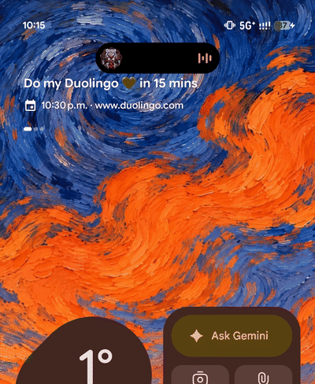
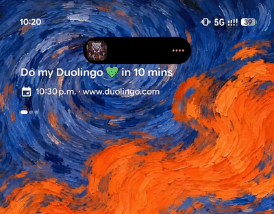
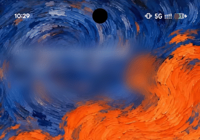
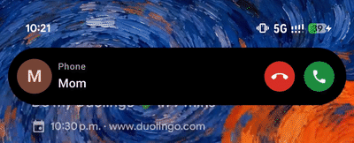
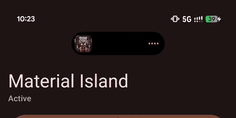
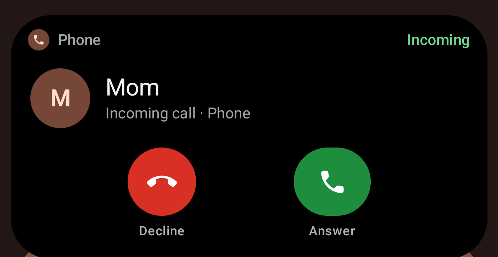
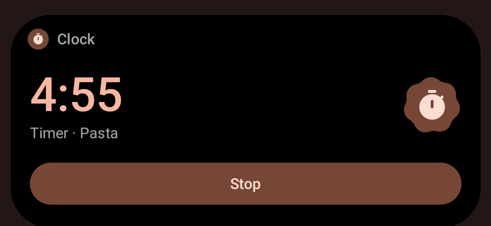
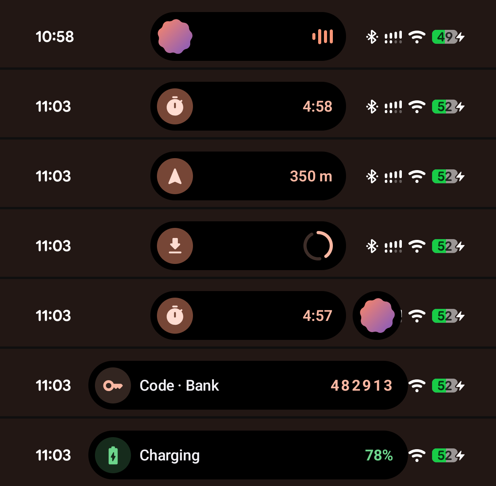
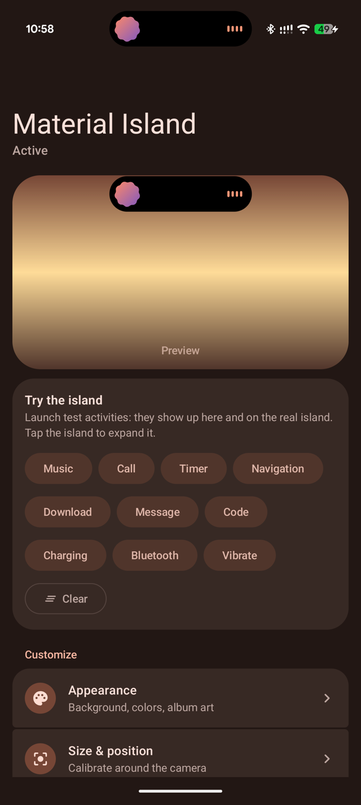

<p align="center">
  <picture>
    <source media="(prefers-color-scheme: dark)" srcset="brand/lockup-horizontal-color-dark.svg">
    
  </picture>
</p>

<p align="center">
  <b>A dynamic island for Android, built the Pixel way.</b><br>
  Material You colour, Material 3 Expressive shapes and springs, wrapped around your camera hole.
</p>

<p align="center">
  
  
  
  
  <a href="LICENSE"></a>
</p>

<p align="center">
  <a href="https://github.com/JotnarDev/material-island/releases/latest"><b>⬇ Download the latest APK</b></a>
</p>

<p align="center">🇪🇸 <a href="README.es.md">Versión en español</a></p>

---

Material Island turns the camera cutout into a live surface for whatever is happening on your
phone: music, calls, timers, navigation, downloads, verification codes and unread chats. It is
made for the Pixel 10 Pro and runs on any phone with Android 12 or newer.

Nothing you see in the island ever leaves the phone. The only part that goes online is **At a glance**, and only if
you turn it on. It is an icon to the left of the camera that opens a card you can swipe through: weather from
Open-Meteo, live scores from ESPN, quotes from Yahoo Finance, and alerts. No account and no tracking. If you're offline,
only that card pauses and the rest of the island keeps working. On a Pixel, one button takes you to the launcher setting
where you can turn Google's own At a glance on or off.

## See it in motion

<table>
  <tr>
    <td width="50%" valign="top"><b>Music in three steps</b><br>Pill, card, then full album art with the controls on a progressive blur.<br><br></td>
    <td width="50%" valign="top"><b>Liquid drop</b> (slow motion)<br>An optional open style: a drop stretches off the camera, breaks away and opens.<br><br></td>
  </tr>
  <tr>
    <td valign="top"><b>Charging</b><br>Wavy ring, count-up and a light sweep. Tap for time to full, speed, cable or wireless, watts and temperature.<br><br></td>
    <td valign="top"><b>Shortcuts from the camera</b><br>Tap the camera at rest for a card of shortcuts you choose.<br><br></td>
  </tr>
  <tr>
    <td valign="top"><b>Calls</b><br>Answer from the island, then keep the call timer in a compact pill.<br><br></td>
    <td valign="top"><b>Messages</b><br>A banner with reply and mark-as-read that goes back into the camera.<br><br></td>
  </tr>
</table>

## Screenshots

<table>
  <tr>
    <td width="50%"></td>
    <td width="50%"></td>
  </tr>
  <tr>
    <td></td>
    <td></td>
  </tr>
  <tr>
    <td></td>
    <td rowspan="2" valign="top"></td>
  </tr>
  <tr>
    <td align="center"></td>
  </tr>
</table>

<sub>All screenshots use the app's built-in demo activities.</sub>

## Features

| Activity | Compact | Expanded |
|---|---|---|
| **Music** | Cookie-shaped album art that spins while playing, plus an equalizer | Art morphs to a square on pause, wavy seek bar you can drag, shape-shifting play button |
| **Calls** | Pulsing green icon with "Incoming" or a live timer | Answer / decline / hang up, styled like the Pixel dialer |
| **Timers** | Live countdown | Big digits plus the Clock app's own actions |
| **Navigation** | Turn arrow and distance | Instruction, arrival time, exit |
| **Downloads & Live Updates** | Progress ring | Wavy progress bar plus actions (Android 16 promoted notifications) |
| **Messages** | Unread chats as bubbles to the left of the island | Read and reply without leaving the app you're in |
| **Verification codes** | Wide pill showing the code; tap to copy | — |
| **System** | Charging, low battery, Bluetooth, ringer mode, airplane mode, headphones | — |

And also:

- **Island first.** Turns off the system's pop-up notifications so the island is the only alert surface. They come back by themselves if the island stops.
- A **second activity** sits next to the island as a small bubble. Tap it to swap.
- **Configurable gestures** on the island (tap, hold, swipe in every direction) and on the resting camera (flashlight, screenshot, quick settings…).
- **Hides itself** in landscape, in fullscreen video and games, and on the lock screen.
- Respects **Do Not Disturb**. Haptics use the Pixel's vibration primitives.
- **Zero frames when idle.** Nothing animates unless something is playing.
- **Everything is adjustable** live: size, position, colours, spring bounce and speed, timings and per-app blocking. Your settings export as JSON.

## Install

### Download

1. Get `material-island-<version>.apk` from the [latest release](https://github.com/JotnarDev/material-island/releases/latest) and open it on your phone. Android will ask you to allow installs from your browser or file manager.
2. Open **Material Island** and turn on what it asks for: **notification access** and the **accessibility service**.
3. On Android 13 and newer, sideloaded apps can't get accessibility right away. If the switch is greyed out, go to
   **Settings → Apps → Material Island → ⋮ → Allow restricted settings**, then try again.
   Or grant everything at once over ADB, as shown below.

Requires Android 12 or newer. A phone with a centred hole-punch camera looks best.

### Xiaomi, Redmi and POCO (HyperOS / MIUI)

HyperOS adds a few extra locks. The app shows a warning card and shortcuts for each of them, but here is the full list:

1. **Restricted settings.** If the accessibility switch is greyed out, try turning it on once. Then go to
   **Settings → Apps → Manage apps → Material Island → ⋮ → Allow restricted settings** and turn it on again.
2. **Accessibility** lives under **Settings → Additional settings → Accessibility → Downloaded apps**.
3. **Autostart.** Go to **Settings → Apps → Manage apps → Material Island** and turn on **Autostart**.
   Without it, HyperOS kills the island after a while.
4. **Battery saver.** On the same screen, set **Battery saver → No restrictions**.
5. **ADB on Xiaomi** can't change secure settings or grant permissions by default. To use the ADB commands below,
   enable **Developer options → USB debugging (Security settings)**. Xiaomi asks you to sign in with a Mi account
   and have a SIM card inserted. Without it, only `cmd notification allow_listener` and `appops set` work.

### Build from source

You need JDK 17 and the Android SDK with the `android-37.2` platform.

```bash
./gradlew assembleRelease
adb install -r app/build/outputs/apk/release/app-release.apk
```

### Grant permissions over ADB

This also skips Android's "restricted setting" warning:

```bash
P=dev.jotnar.materialisland
adb shell cmd notification allow_listener $P/$P.service.IslandNotificationListener
adb shell settings put secure enabled_accessibility_services $P/$P.service.IslandAccessibilityService
adb shell dumpsys deviceidle whitelist +$P
adb shell pm grant $P android.permission.BLUETOOTH_CONNECT
adb shell appops set $P RECEIVE_SENSITIVE_NOTIFICATIONS allow   # verification codes on Android 15+
adb shell pm grant $P android.permission.WRITE_SECURE_SETTINGS     # "Island first"
```

> [!WARNING]
> `settings put … enabled_accessibility_services` **replaces** the whole list. If you already use
> other accessibility services, append them separated by `:`.

Optionally, hide Android's own notification icons from the status bar, since the bubbles replace them. This resets when the phone reboots:

```bash
adb shell cmd statusbar send-disable-flag notification-icons   # use "none" to bring them back
```

## How it works

- **The window** is a `TYPE_ACCESSIBILITY_OVERLAY` owned by an accessibility service. That lets it
  draw over the status bar without the "display over other apps" permission. The service only
  watches which app is in the foreground, so it can hide music while that app is open. It never
  reads screen content.
- **Only the island takes touches.** The rest of the window is passed through using the hidden
  `ViewTreeObserver.OnComputeInternalInsetsListener`. That API is limited to apps targeting
  SDK 30 or lower, so it is unlocked with [HiddenApiBypass](https://github.com/LSPosed/AndroidHiddenApiBypass).
- **The data** comes from a `NotificationListenerService` (calls, timers, navigation, Live Updates,
  codes and chats), from `MediaSessionManager` (music, with the album colour picked by Palette)
  and from system broadcasts.
- **The camera position** is read from the display cutout path, so the island lines up with the
  real hole on any device. You can fine-tune it with calibration mode.

## Project map

```
app/src/main/java/dev/jotnar/materialisland/
├── data/IslandSettings.kt     ← every setting and its default
├── model/IslandItem.kt        ← activity kinds and their priority
├── core/
│   ├── IslandStore.kt         ← source of truth: ongoing activities, alert queue, unread chats
│   ├── NotificationParser.kt  ← notification → activity (add new rules here)
│   ├── MediaMonitor.kt        ← media sessions and album colour
│   ├── SystemEventMonitor.kt  ← charging, Bluetooth, ringer…
│   ├── Actions.kt             ← opening apps, flashlight, haptics
│   └── Demo.kt                ← fake activities for testing
├── overlay/
│   ├── IslandView.kt          ← the island itself: modes, sizes, colours, cards
│   ├── Components.kt          ← wavy bar, morphing art, equalizer
│   ├── IslandOverlay.kt       ← window, touch region, gestures, expand/collapse
│   └── Geometry.kt            ← finds the camera hole
├── service/                   ← accessibility service and notification listener
└── ui/                        ← the settings app
```

**Quick recipes**

- **Change a default:** edit `data/IslandSettings.kt`.
- **Add a new kind of activity:**
  1. Add it to `Kind` in `model/IslandItem.kt`.
  2. Detect it in `NotificationParser.parse`.
  3. Draw it in `CompactLeft`, `CompactRight` and `Card` in `IslandView.kt`.
- **Tweak the motion:** see `IslandBody` in `IslandView.kt` (`sizeSpec`, `transitionSpec`).
- **Use a different album-art shape:** change `artMorph` in `Components.kt`. Any `MaterialShapes.*` works.

## Built with

Kotlin 2.4 · Jetpack Compose (BOM 2026.11) · Material 3 Expressive (`MaterialShapes`, `MotionScheme.expressive()`, `LoadingIndicator`) · `androidx.graphics.shapes` morphing · AGP 9.5 · kotlinx.serialization · HiddenApiBypass.

## Identity

The logo, **Split**, shows the island and the camera dot pulling apart, caught mid-spring. That is
the same gesture the island makes when a second activity pops out beside it. The logo files, colours
and usage guide are in [`brand/`](brand/).

## Credits

These projects provided ideas. Material Island's code is its own.

- [Expressive Cutout](https://github.com/EvanKoe/expressive-cutout): accessibility-overlay window, touch region, Expressive look
- [Dynamic Island for Android](https://github.com/ajitpal/dynamic-island-android): notification parsing
- [LiveBridge](https://github.com/appsfolder/livebridge): verification-code detection
- [OmniLand](https://github.com/andrasulthan-alt/OmniLand): secondary bubble, system events, resting gestures
- [SmartIsland](https://github.com/agupta07505/SmartIsland): quick reply and expanded cards

## License

[MIT](LICENSE) © JotnarDev
