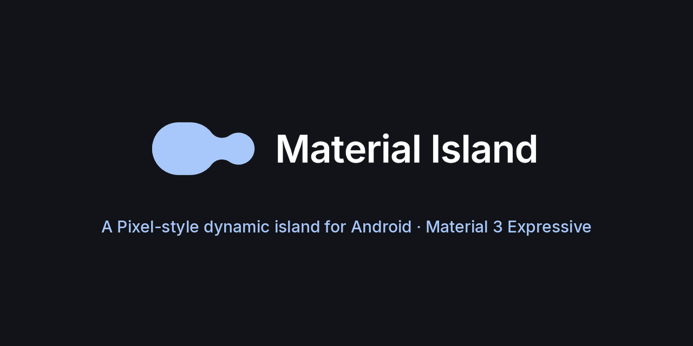

# Material Island — identity

## The idea

**Split**: the island and the camera dot pulling apart, caught mid-spring. It is the gesture the
island makes when a second activity pops out next to it, drawn with Material 3 Expressive's
liquid motion. One silhouette, no outlines, built from circles and tangent arcs.

## Colours

| Name | HEX | RGB | Use |
|---|---|---|---|
| **Ink** | `#111318` | 17 19 24 | The island itself. Primary colour of the mark and wordmark |
| **Blue 40** | `#0B57D0` | 11 87 208 | Mark on light backgrounds, links |
| **Blue 80** | `#A8C7FA` | 168 199 250 | Mark on dark backgrounds |
| **Blue 90** | `#D3E3FD` | 211 227 253 | App icon tile, soft surfaces |

These are tones from Material's blue palette, so the identity sits naturally inside Material You.

## Files

| File | When |
|---|---|
| `symbol.svg` / `-white` / `-blue` | Symbol alone: avatars, stickers, watermark |
| `symbol-small.svg` | **24 px and below** (favicon, notification icon). It has a thicker neck so the join doesn't close up |
| `lockup-horizontal*.svg` | Default logo: headers, README, banners (`-color`, `-color-dark`, `-white`) |
| `lockup-stacked.svg` | Square-ish spaces |
| `wordmark.svg` | Name alone, when the symbol is already nearby |
| `app-icon.svg` / `-dark` | Store and preview tiles |
| `png/` | Ready-made PNG exports and banners (1280×640, also works as GitHub's social preview) |

In the app, the adaptive icon is `app/src/main/res/drawable/ic_launcher_*`. It has an ink
foreground on a Blue 90 background, plus a monochrome layer for themed icons.

## Typography

The wordmark is **Inter SemiBold** with slightly tightened tracking, converted to outlines, so
you don't need the font installed. Inter is licensed under SIL OFL 1.1, which allows logo use.

## Usage rules

- **Clear space**: keep a margin around the logo at least the diameter of the satellite dot on every side.
- **Minimum size**: the symbol at 16 px (use `symbol-small`), and the horizontal logo at 24 px high.
- **Backgrounds**: Ink on white or light surfaces. White or Blue 80 on Ink or dark photos.
- **Don't**:
  - stretch the logo or rotate it;
  - add outlines, shadows or gradients;
  - split the dot from the island, because the join *is* the idea;
  - recolour the dot alone;
  - set the name in another font.

## Concepts

The three explored directions are in `concepts/`. A was Cookie Island, B was Split (chosen) and C
was Island on the wave.

> This logo has not been through a trademark search. Do one before any commercial use.
